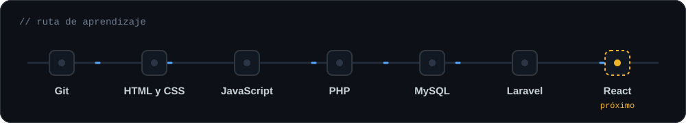

  

  
  
  

---

## 01 · Sobre mí

Soy aprendiz de Tecnología en Análisis y Desarrollo de Software en el SENA, en Medellín.

Mi camino empezó en los circuitos: en el colegio hice una media técnica en Electricidad, en articulación con el SENA. Ahí aprendí a seguir un sistema de punta a punta para entender por qué funciona o por qué falla. Hoy aplico esa misma forma de pensar al código: no me basta con que algo funcione, quiero saber cómo funciona.

Me interesa el desarrollo web y la gestión de bases de datos. Disfruto convertir una necesidad real en una aplicación que la gente use todos los días.

| | |
| --- | --- |
| **Formación** | Tecnólogo en Análisis y Desarrollo de Software · SENA · 2025 – 2027 |
| **Base técnica** | Bachiller técnico en Electricidad · articulación con el SENA |
| **Enfoque** | Desarrollo web · Backend con PHP y Laravel · Bases de datos |
| **Busco** | Mi etapa productiva en un equipo de desarrollo |

---

## 02 · Tecnologías

  

| Área | Tecnologías |
| --- | --- |
| **Frontend** | HTML · CSS · JavaScript |
| **Backend** | PHP · Laravel · API REST |
| **Bases de datos** | MySQL · SQL · modelado relacional |
| **Otros lenguajes** | C# · Python |
| **Herramientas** | Git · GitHub · herramientas de IA para desarrollo |

---

## 03 · Ruta de aprendizaje

  

---

## 04 · Proyecto destacado

### EDEA PRO — Sistema de gestión para peluquería canina y felina

Aplicación web para agendar citas y gestionar clientes, desarrollada en equipo como proyecto formativo del SENA.

**Mi participación:** estuve en todas las etapas del proyecto.

- **Base de datos:** diseño del modelo en MySQL y automatizaciones con triggers.
- **Backend:** controladores y rutas en Laravel para citas, clientes y usuarios.
- **Frontend:** pantallas adaptables a celular con HTML, CSS y JavaScript.
- **Trabajo en equipo:** control de versiones con Git y GitHub.

**Lo que hace el sistema:**

- Agendamiento de citas con reglas de negocio (reagendar con 24 horas de anticipación, cancelar con motivo).
- Paneles para tres tipos de usuario: cliente, peluquero y administrador.
- Reportes en PDF y Excel, gráficas de seguimiento y mapa de ubicación.
- Notificaciones automáticas desde la base de datos.

**Hecho con:** Laravel · MySQL · JavaScript · HTML · CSS · Chart.js · Leaflet

---

## 05 · Cómo trabajo

| Habilidad | En la práctica |
| --- | --- |
| **Trabajo en equipo** | Construí EDEA PRO en equipo, coordinando los cambios con Git y GitHub. |
| **Responsabilidad** | Cumplo mis entregas del SENA mientras trabajo por días. |
| **Puntualidad** | Organizo la semana entre clases, proyecto y trabajo. |
| **Resolución de problemas** | Sigo un error de punta a punta, como un circuito, hasta encontrar dónde falla. |
| **Aprendizaje continuo** | Repaso las bases desde cero cuando algo no me queda claro. |

**Metodologías:** Scrum · historias de usuario · Taiga · control de versiones con Git

---

## 06 · Metas

- Consolidar mis bases en JavaScript, PHP y Laravel.
- Aprender React para el frontend.
- Hacer mi etapa productiva en un equipo de desarrollo real.
- Publicar más proyectos propios en este perfil.

---

  <code>// de los circuitos al código — Felipe Celis Montoya</code>

