  

## Sobre mí
 
Soy aprendiz de Tecnología en Análisis y Desarrollo de Software en el SENA, en Medellín.
 
Antes de programar estudié una media técnica en Electricidad, así que llegué al software desde los circuitos. De ahí me quedó la costumbre de querer entender cómo funcionan las cosas por dentro, no solo hacer que funcionen.
 
Estoy buscando mi etapa productiva en un equipo de desarrollo.
 
## Tecnologías
 
| Frontend | Backend | Bases de datos | Herramientas |
| --- | --- | --- | --- |
| HTML · CSS · JavaScript | PHP · Laravel | MySQL · SQL | Git · GitHub |
 
También he trabajado con **C#** y **Python**.
 
## Proyecto destacado
 
**EDEA PRO** — Sistema de gestión para peluquería canina y felina.
Aplicación web para agendar citas y gestionar clientes, desarrollada en equipo como proyecto formativo del SENA con Laravel, MySQL y JavaScript.
 
## Contacto
 
[LinkedIn](https://www.linkedin.com/in/felipe-celis-79215a451/) · celisfelipe37@gmail.com
